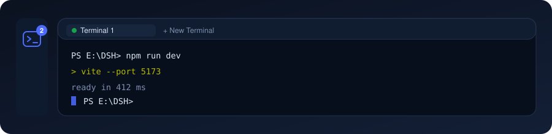

<p align="center">
  
</p>

# dsh-plugin-terminal-panel

English | [中文](README.md)

[](https://www.npmjs.com/package/dsh-terminal-panel)
[](LICENSE)
[](https://github.com/BaiZhi967/dsh-plugin-terminal-panel)

**Real terminals inside the DeepSeek Harness web UI.** One click in the sidebar adds a terminal panel beside the Conversation panel. Each tab is a real PTY (node-pty / ConPTY) — not a fake output box, and no OS window.

- The PTY lives in the **DSH host process**; output is streamed to the page over SSE;
- Closing or reloading the page does not kill anything: terminals keep running and **replay the last 256 K characters**, so the screen comes back;
- The PTY is resized with the panel, so full-screen programs redraw correctly;
- The same terminals are exposed to the **agent as a tool set**: the model can open a terminal, run commands and read the output.

## ✨ Features

| Feature | Detail |
|---|---|
| **Sidebar entry** | One terminal icon in the sidebar's panel-icon row, next to the built-in Plugins icon. Clicking it switches the main column to the terminal panel — the same mechanism the Conversation panel uses |
| **Active count** | A live badge on the icon shows how many terminals are running (hidden at zero); the tooltip carries the count too |
| **Per-device shell detection** | The host probes **what this machine really has** before listing anything: on Windows PowerShell 7 / Windows PowerShell / Command Prompt / Git Bash / **one entry per WSL distribution** / Nushell; on macOS the login shell (`$SHELL`, moved to the front) / zsh / bash / fish / sh / Nushell / PowerShell 7 / ksh / tcsh; on Linux whatever `PATH` and `/etc/shells` provide. The list is grouped by **shell family** (PowerShell / Windows / WSL / Bash / Zsh …), every entry saying what it is and where it lives, and types this machine lacks are listed under "Not installed" instead of being offered |
| **Shell picker** | "+ New Terminal ▾" is one segmented control: the left half opens a terminal immediately, the right half opens the options — headed by this device (name · arch · hostname), grouped by family. The one you pick becomes the default; hit ⟳ to re-detect after installing a shell |
| **Settings panel** | The ⚙ in the panel header opens the settings: the **default shell** (automatic or a specific installed one, grouped by family and headed by this device, with the missing types spelled out) and the **"inject terminal tools into the agent"** switch. Settings live in `<DSH_HOME>/terminal-panel/settings.json`, so they survive restarts and browsers |
| **Default directory** | A new terminal starts in the **user home directory** (`C:\Users\<you>` / `~`), exactly like a terminal opened by the OS. The new-terminal menu accepts any directory (with `~` and relative paths), and the agent can pass `cwd` |
| **Tabs** | Several terminals in one panel (up to 12), each with a status dot and a close button; hovering a tab shows its shell and directory, and the header shows the active terminal's shell · directory |
| **Rename** | Double-click a tab, or use its ✎ button; `Enter` commits, `Esc` cancels, blur commits. CJK and emoji round-trip correctly |
| **Own VT engine** | A small terminal renderer written for this plugin: ANSI colour (16 / 256 / truecolor), cursor addressing, erase, alternate screen, scroll regions, wide characters |
| **Theme aware** | Separate light and dark ANSI palettes: on a light theme `37` / `93` map to dark grey / dark yellow, so PowerShell's input highlighting stays readable |
| **Text selection** | The ⧉ button in the tab bar pauses keyboard input so you can select and copy output |
| **IME input** | A dedicated input channel: composed Chinese, CJK and emoji reach the PTY correctly |
| **Agent tools** | Nine `terminal_*` tools (create, list, read, exec, write keystrokes, rename, resize, close, detect shells) over the very same terminals the user sees; the injection can be switched off in the settings |
| **Live reload** | Edit `impl.js` and `POST /__reload` — no DSH restart, and the **tool definitions reload with it**. Terminals that are already open stay usable |

## 📦 Install

Install from npm (package [`dsh-terminal-panel`](https://www.npmjs.com/package/dsh-terminal-panel)):

```sh
dsh plugin --profile web add dsh-terminal-panel
dsh --profile web
```

Reload the page once and the terminal icon appears in the sidebar.

> Plain JavaScript: no build step, no runtime dependencies.
> If the package cannot be resolved, the mirror usually has not synced the latest version yet — install once against the official registry, or retry later:
> `dsh plugin --profile web add dsh-terminal-panel --registry=https://registry.npmjs.org/`
> Requirements: DSH `>= 0.2.0-rc.2`, Node `^22.19.0 || >=24.0.0`, and a host with a working PTY (this plugin uses `subprocess.spawnTerminal`, i.e. the bundled node-pty).

## 🚀 Usage

1. Click the **terminal icon** in the sidebar → the terminal panel opens in the main column.
2. Click **+ New Terminal** → a PTY is allocated immediately in the home directory with the remembered (or default) shell. The **▾** next to it opens the menu: this device at the top, the probed shells grouped by family below, the types that are missing in their own block — choose a shell, type a working directory, or hit ⟳ to re-detect.
3. Type directly in the panel (clicking it focuses the input).
4. Double-click a tab (or use ✎) to rename; ✕ closes the terminal and terminates its process tree.
5. The panel resizes the PTY automatically as the window changes.

### Git Bash and cmd

There is nothing to switch on. The host probes `%ProgramFiles%\Git\bin\bash.exe`, `%LOCALAPPDATA%\Programs\Git\bin\bash.exe`, scoop roots, and the directory derived from a resolved `git.exe` (`..\bin\bash.exe`). **Git Bash is offered only when Git for Windows is really installed**, and `C:\Windows\System32\bash.exe` (the WSL launcher) is explicitly excluded — a WSL `bash` is never passed off as Git Bash. `powershell.exe` / `cmd.exe` are verified the same way.

### How the shell types are recognised

"Which shells does this machine have" is **probed from the host process**, never a hard-coded list; it runs again when the panel opens, when you hit ⟳ re-detect, and when the settings are saved:

| Platform | Where it looks |
|---|---|
| Windows | `PATH`, `%ProgramFiles%\PowerShell\7\pwsh.exe`, `%LOCALAPPDATA%\Microsoft\WindowsApps\pwsh.exe`, `%SystemRoot%\System32\WindowsPowerShell\v1.0\powershell.exe`, `%COMSPEC%`, the Git for Windows tree (including `..\bin\bash.exe` derived from a resolved `git.exe`, with the `System32\bash.exe` WSL launcher excluded), and **every WSL distribution** (`wsl.exe --list`; each distribution becomes a `wsl:<name>` entry started with `wsl.exe -d <name>`) |
| macOS | `$SHELL` (the login shell is moved to the front — that is what "Automatic" picks), `/etc/shells`, plus zsh / bash / fish / sh / Nushell / PowerShell 7 / ksh / tcsh under `/opt/homebrew/bin`, `/usr/local/bin`, `/opt/local/bin`, `/usr/bin`, `/bin` |
| Linux | `$SHELL`, `/etc/shells`, plus bash / zsh / fish / sh / Nushell / PowerShell 7 / ksh / tcsh under `/usr/local/bin`, `/usr/bin`, `/bin`, `/snap/bin`, `/run/current-system/sw/bin` |

Types that were not found land in `missingShells`: the UI shows them under "Not installed" (with a line saying what they are) and the tool output carries a `Not installed: …` line. The device itself (name · arch · hostname · login shell) is probed by the host and returned alongside, so **the same configuration lists different types on different machines**.

## 🧰 Agent tools

On load the plugin registers these tools in the DSH tool registry (globally visible; callable under both the `native` and `ptc` presets):

| Tool | Purpose |
|---|---|
| `terminal_shells` | Which shells this machine can really run (each with a `family` and an `about` line), the default one, the default working directory, plus the device itself (`device`: name / arch / hostname / login shell / WSL) and the types that are **not installed** (`missingShells`) — check it before asking for Git Bash |
| `terminal_list` | Every open terminal: id, title, shell, directory, status, size |
| `terminal_create` | Open a terminal with optional `shell` / `cwd` (`~` and relative paths supported) / `title` / size; returns its id |
| `terminal_read` | Read a terminal's output as plain text (ANSI escapes and `\r` redraws removed), **offset-based and non-consuming** |
| `terminal_write` | Send raw keystrokes: text, `\u0003` (Ctrl+C), `\u001b[A` (arrow up), … |
| `terminal_exec` | **Run one command line** in a terminal and wait for it, returning the output produced; shell state (cwd, variables, history) persists between calls |
| `terminal_resize` | Change the terminal size |
| `terminal_rename` | Rename a terminal tab so user and model can tell them apart |
| `terminal_close` | Close a terminal (optionally removing it from the panel list) |

About "wait for the command": a PTY has no shell-integration handshake, so settling is a **heuristic** and the result says which signal ended the wait — `idle` (a child process finished and went quiet), `quiet` (it only went quiet; a long silent command may still be running), `exited`, `timeout`. A timeout never kills the command: keep reading with `terminal_read(offset=nextOffset)`, or wait again with a larger `idleMs` / `timeoutMs`.

Terminals created by the model and by the user live in **one list**: you can watch the model's commands in the panel and keep typing in them yourself.

## ⚙️ Settings

Click the **⚙** in the panel header (present even with no terminals open) to open the settings:

| Setting | Detail |
|---|---|
| **Default shell** | "Automatic" = the first available shell in **this device's order**: on Windows `pwsh → powershell → cmd → Git Bash → WSL → Nushell → bash`, on macOS / Linux the device's login shell (`$SHELL`) first. Or pin one installed shell. It drives both the panel's "+ New Terminal" and `terminal_create` when the model omits `shell`. If the pinned shell is uninstalled, the plugin falls back to Automatic and says so in the settings |
| **Inject terminal tools into the agent** | On: the model may call the nine `terminal_*` tools. Off: they are **removed from the tool registry immediately**, so the very next model call no longer sees them — no restart, no config edit. **Running terminals and existing conversations are unaffected** and it can be switched back on at any time |

Settings are stored in `%DSH_HOME%\terminal-panel\settings.json` (by default `~/.dsh/terminal-panel/settings.json`); if the file cannot be written the value still applies for this run and the panel says so. Because the settings live on the host, they are shared by every browser and survive a restart.

## 🧱 Layout

```
dsh-plugin-terminal-panel/
├── host.js           # Host entry: route carrier, tool attach, reload shell
├── impl.js           # Host implementation: PTY lifecycle, shell probing, SSE, agent tools
├── client.js         # Client: terminal panel, sidebar icon, VT engine, new-terminal menu
├── cordis.patch.yml  # Bundle patch: inserts the plugin row into a profile
└── package.json      # dsh.bundle.patch + dsh.client declarations
```

How the halves fit together:

```
sidebar icon / terminal panel (client.js)
        │  same-origin HTTP (loopback)
        ▼
GET  /system-terminals/api/stream?id=…   ← SSE: replay buffer, then live output
POST /system-terminals/api/{list,shells,create,write,read,exec,resize,close,rename,remove}
        ▼
impl.js ── subprocess.spawnTerminal() ──► real PTY (node-pty / ConPTY)
        ▲
        └── ctx.tools.register(terminal_*) ──► agent tools (visible in native and ptc)
```

The split is deliberate: **a loaded ESM module stays cached for the life of the host process**, so `host.js` stays tiny and pulls the logic in through a cache-busted dynamic `import()`. Replacing `impl.js` and calling `POST /__reload` therefore takes effect without restarting DSH. Both the terminal registry and the tool registration live on the `impl.js` side: a reload **takes over** the previous registration (the old tools are disposed before the new ones are registered), so a reload neither fails on duplicate names nor orphans running terminals.

### Local API

Routes live under `/system-terminals/api`, bound to DSH's own loopback address and requiring no login (same as other private plugin routes in the ecosystem).
**Every mutating (`POST`) route requires an `x-dsh-terminal: 1` header**: a cross-origin page cannot set a custom header (its preflight is never granted), so no random page you open in the browser can drive your terminals — which matters because `POST /exec` runs commands.

| Method | Purpose |
|---|---|
| `GET /health` | Version, platform, available shells, default directory, PTY availability, tool-registration status (`host`) |
| `GET /shells` | Shell probe: `{platform, osKind, device, shells:[{id,label,family,about,path,args,source,default}], missing:[…], missingShells:[{id,label,family,about}], defaultShell, defaultCwd, sessions}`; `POST {refresh:true}` re-detects |
| `GET /settings` | Current settings: `{defaultShell, effectiveShell, autoShell, toolsEnabled, toolsRegistered, settingsPath, shells…}` |
| `POST /settings` | `{defaultShell?: installed shell id or "auto", toolsEnabled?: boolean}` → save and apply immediately |
| `GET /list` | Terminal list (id, title, shell, cwd, pid, size, status, resizable) |
| `POST /create` | `{shell?, cwd?, title?, cols?, rows?}` → new terminal |
| `POST /write` | `{id, data}` → write raw UTF-8 bytes to the PTY |
| `POST /read` | `{id, offset?, maxChars?, lines?}` → incremental plain-text read |
| `POST /exec` | `{id, command, wait?, timeoutMs?, idleMs?, maxChars?, lines?}` → run and wait |
| `POST /resize` | `{id, cols, rows}` |
| `POST /close` | `{id, remove?}` → terminate the process (with `remove:true`, drop it from the list too) |
| `POST /rename` | `{id, title}` → rename (whitespace-collapsed, 60 chars max) |
| `POST /remove` | `{id}` → drop an exited terminal from the list |
| `GET /tools` | The agent tool set that would be registered (name / description / parameter schema) |
| `GET /stream?id=` | SSE: `history` / `data` / `status` / `exit` events with base64 payloads |
| `POST /__reload` | Development: reload `impl.js` (re-registering the tools too) |

## 📝 Changelog

See [CHANGELOG.md](CHANGELOG.md).

## 📄 License

[MIT](LICENSE) © 2026 BaiZhi967
